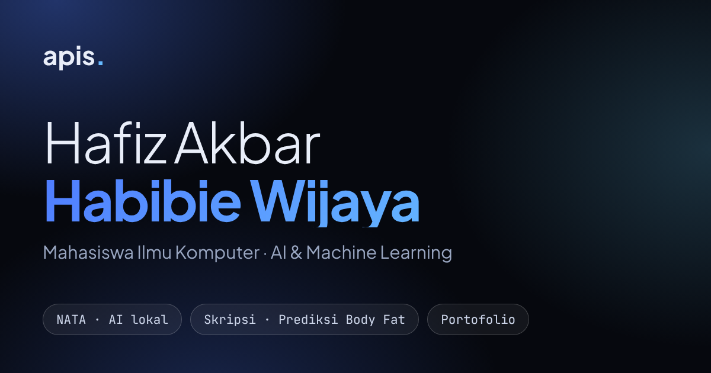

# Tugas 3 Komputasi Awan: Deployment Website ke Cloud Hosting

Website portofolio statis berbasis HTML, CSS, dan JavaScript murni yang di-deploy ke GitHub Pages untuk memenuhi tugas mata kuliah Komputasi Awan.


🔗 **Lihat situs live:** [https://apiss77.github.io/tugas3-cloud-23.53.028035/](https://apiss77.github.io/tugas3-cloud-23.53.028035/)

---

## Tentang Proyek

Website ini dibangun sebagai pemenuhan Tugas 3 pada mata kuliah Komputasi Awan, Program Studi Ilmu Komputer, Universitas Muhammadiyah Palangkaraya. Fokus utama tugas ini adalah merancang situs web statis tanpa *framework* maupun *build step*, lalu mengunggah dan memublikasikannya secara otomatis menggunakan layanan *cloud hosting* GitHub Pages. Selain menampilkan portofolio pribadi dan progres riset skripsi, situs ini menyediakan materi komputasi awan dan catatan teknis pengembangan secara interaktif.

## Fitur Utama

- **Desain Glassmorphism Ringan**: Antarmuka bertema gelap (*dark mode*) dengan efek kaca yang telah dioptimalkan agar guliran layar (*scroll*) tetap mulus.
- **Pipeline Data Skripsi Interaktif**: Visualisasi tahapan data dari prapemrosesan, seleksi fitur (*SelectKBest*), perbandingan tiga model, evaluasi, hingga penjelasan SHAP untuk estimasi lemak tubuh (*body fat*).
- **Simulasi Percakapan NATA**: Demonstrasi alur kerja asisten AI lokal berbahasa Indonesia dengan memori berlapis dan eksekusi berbasis graf (DAG).
- **Peta Model Layanan Cloud**: Diagram tanggung jawab interaktif untuk model On-Premises, IaaS, PaaS, dan SaaS pada halaman Materi.
- **Riwayat Versi Terintegrasi**: Pelacak status versi website pada halaman Portofolio yang tersinkronisasi otomatis dengan lencana di footer.
- **View Transitions**: Transisi visual halus saat berpindah antarhalaman pada peramban yang mendukung.
- **Aset Lokal Mandiri**: Tipografi *Plus Jakarta Sans* dan *JetBrains Mono* disajikan langsung dari format woff2 lokal tanpa ketergantungan CDN eksternal.

## Halaman

| Halaman | Berkas | Deskripsi Singkat |
| --- | --- | --- |
| **Beranda** | `index.html` | Profil mahasiswa, ringkasan keahlian, kartu proyek unggulan (NATA dan Skripsi), alur penelitian, diagram arsitektur, dan kontak. |
| **Materi** | `materi.html` | Materi dasar Komputasi Awan: definisi, model layanan (SaaS, PaaS, IaaS) beserta diagram interaktif, serta ringkasan manfaat dan risikonya. |
| **Portofolio** | `portofolio.html` | Dokumentasi tugas akademik (Tugas 1 dan 2), panduan langkah *deployment* ke GitHub Pages, dan tabel riwayat versi. |
| **Devlog** | `devlog.html` | Catatan pengembangan berkala asisten AI NATA per sprint (Sprint 1 hingga 6) beserta status penyelesaian. |
| **404** | `404.html` | Tampilan responsif penanganan kesalahan apabila rute atau URL berkas tidak ditemukan. |

## Struktur Berkas

```text
.
├── .github/
│   └── workflows/
│       └── check.yml           # Workflow pengujian otomatis (CI)
├── assets/
│   ├── css/
│   │   └── style.css           # Gaya tampilan, tema, dan glassmorphism
│   ├── fonts/                  # Font web lokal (woff2)
│   │   ├── jetbrains-mono-latin-wght-normal.woff2
│   │   └── plus-jakarta-sans-latin-wght-normal.woff2
│   ├── images/                 # Aset gambar, favicon, ikon, dan banner
│   │   ├── apple-touch-icon.png
│   │   ├── favicon.svg
│   │   ├── foto-profil.jpg
│   │   ├── latar-kaca.svg
│   │   └── og-image.png
│   └── js/
│       └── script.js           # Logika interaksi, simulasi, dan tilt kartu
├── .htmlvalidate.json          # Konfigurasi linter html-validate
├── 404.html                    # Halaman galat 404
├── devlog.html                 # Halaman devlog NATA
├── index.html                  # Halaman utama (beranda)
├── lighthouserc.json           # Konfigurasi audit performa Lighthouse CI
├── materi.html                 # Halaman materi komputasi awan
├── portofolio.html             # Halaman portofolio dan deployment
└── README.md                   # Dokumentasi repositori
```

## Menjalankan Secara Lokal

Website ini tidak membutuhkan instalasi dependensi runtime khusus. Anda dapat menjalankannya dengan cara:

1. **Membuka Langsung**: Buka berkas `index.html` langsung menggunakan peramban web pilihan Anda.
2. **Menggunakan Web Server Lokal**:
   ```bash
   # Opsi 1: Menggunakan npx serve
   npx serve .

   # Opsi 2: Menggunakan Python
   python -m http.server 8000
   ```
   Setelah server aktif, akses alamat `http://localhost:8000` melalui peramban.

## Langkah Deployment ke GitHub Pages

1. Masuk ke halaman repositori di GitHub.
2. Klik tab **Settings** di bagian atas.
3. Pada bilah navigasi kiri, pilih menu **Pages** (di bawah menu *Code and automation*).
4. Di bagian **Build and deployment**:
   - Sumber (*Source*): Pilih **Deploy from a branch**.
   - Cabang (*Branch*): Pilih **`main`** dan direktori **`/ (root)`**.
5. Klik tombol **Save**. GitHub Pages akan memproses dan menyajikan situs pada URL yang telah ditentukan.

## Pemeriksaan Kualitas Otomatis

Repositori ini telah dilengkapi integrasi pengujian otomatis via GitHub Actions (`.github/workflows/check.yml`) yang berjalan setiap kali terdapat pembaruan kode pada branch `main`:

- **html-validate**: Memvalidasi seluruh sintaks berkas HTML terhadap standar W3C untuk mencegah galat struktur markup.
- **Lighthouse CI**: Menguji kualitas teknis halaman web mencakup metrik performa, aksesibilitas (*accessibility*), praktik terbaik (*best practices*), dan optimasi mesin pencari (SEO).

## Catatan Pengembangan

### Panduan Pembaruan Versi 2
Footer pada keempat halaman HTML saat ini menampilkan lencana **Versi 1.0**. Untuk menerbitkan pembaruan versi 2:
1. Ubah teks `Versi 1.0` menjadi `Versi 2.0` pada elemen footer di berkas `index.html`, `materi.html`, `portofolio.html`, dan `devlog.html`.
2. Komponen daftar riwayat versi di halaman `portofolio.html` akan mendeteksi string tersebut dan secara otomatis menandai versi 2.0 sebagai "Saat ini".
3. Simpan perubahan dan lakukan commit dengan pesan `Pembaruan versi 2`, lalu dorong (*push*) ke branch `main`.

---

### Identitas Pengembang

- **Nama**: Hafiz Akbar Habibie Wijaya
- **NIM**: 23.53.028035
- **Program Studi**: Ilmu Komputer
- **Perguruan Tinggi**: Universitas Muhammadiyah Palangkaraya (UMPR)
- **Repositori**: [tugas3-cloud-23.53.028035](https://github.com/Apiss77/tugas3-cloud-23.53.028035)
- **Profil GitHub**: [@Apiss77](https://github.com/Apiss77)
